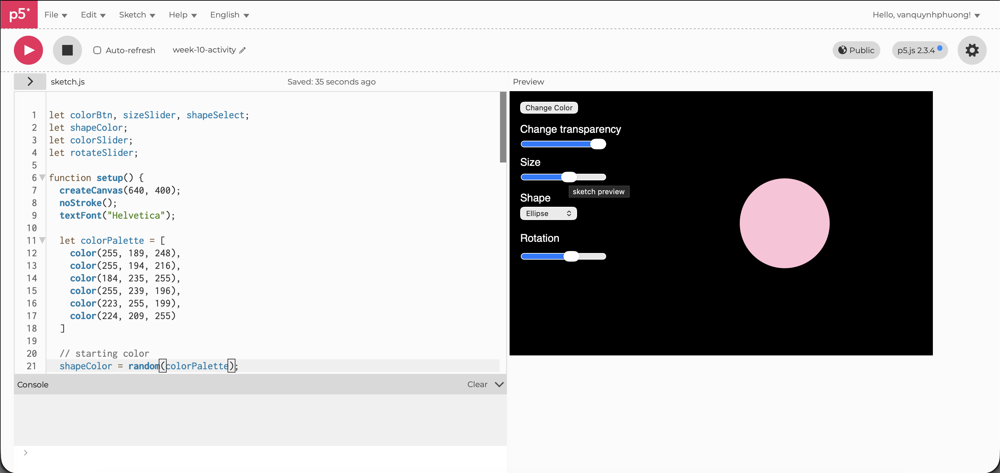
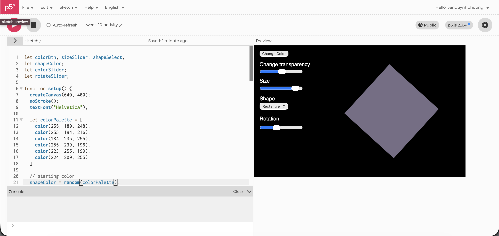

# Week 9 — Sensor to Screen

---

### Activities

| Activity | What I Made                   |
| -------- | ----------------------------- |
| `10` | The shape changes size, colour, transparency, type of shapes, and rotates when interacting with the buttons and the sliders. |

---

### This Week

In summary, this week I learnt about different UI elements, how to use and style them!

---

### Output

---

### 10

This is (hopefully) the only day that I self-studied the code. I did have to experiment a bit to understand the lesson as it was not that easy. However, the process of applying it was quite fun, and I think it would be really helpful with my future career in doing UI work!

--- 