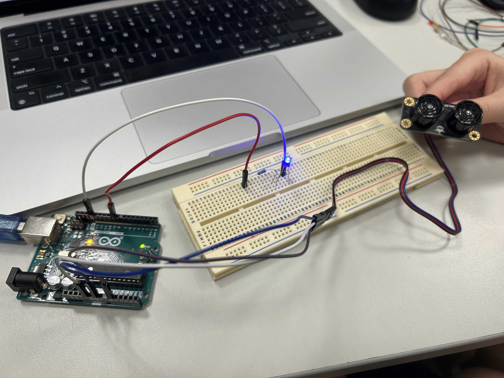
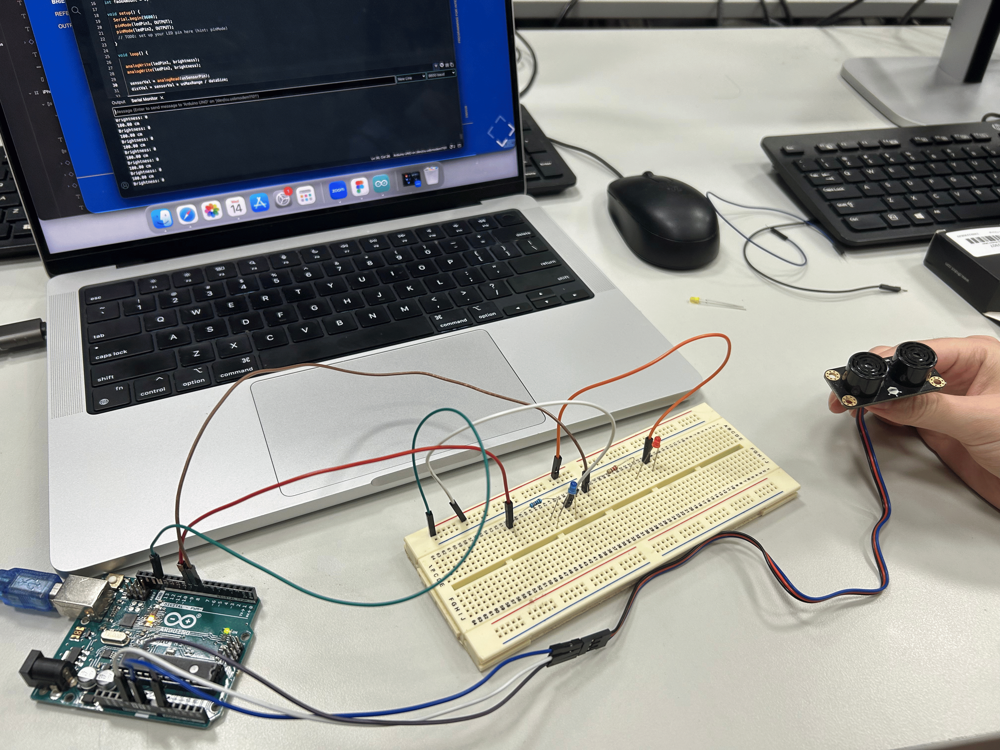

# Week 9 — Sensor to Screen

---

### Activities

| Activity | What I Made                   |
| -------- | ----------------------------- |
| `9a` | The LED reacts to the distance between me and the sensor |

---

### This Week

In summary, I have learnt some more advanced features compared to last week, including data types, dynamic vs. static / strong vs. weak typing, returns type, remapping, how to read data sheets, serial and libaries. 

---

### Output

---

### 9a   

To be honest, it wasn't that challenging since we did learn about LED set up and ultrasonic sensor in previous weeks. It was a good opportunity for us to reflect and apply what we learnt into an exercise! We did face some problem regarding the wires, but with the help of Kapi, we figured out how to prevent it as much as possible by reducing the number of wires.

--- 
