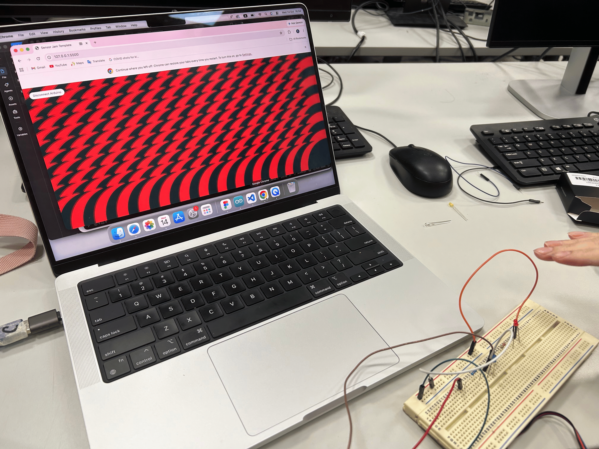
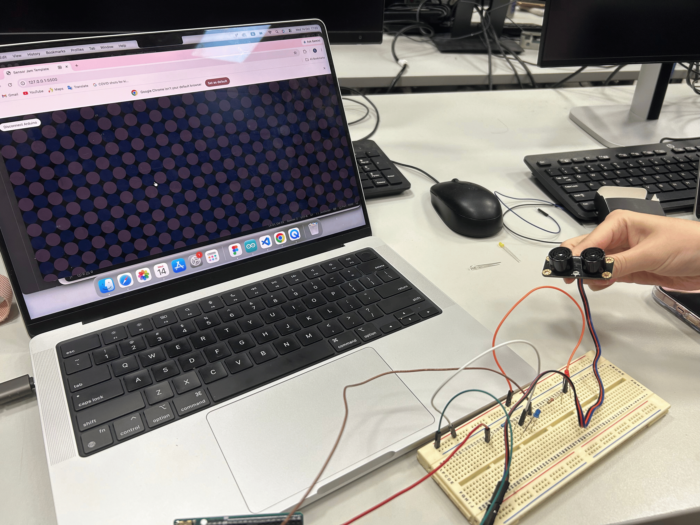

# Sensor Jam — Kaleidoscope

---

### The Project

A screen-size pattern of circle that will change their size based on the distance betweent us and the sensor that resembles kaleidoscope.

---

### Output

---

### ✍️ Reflection

I have utilized one of my old code that I made in week 2-3, which was a code that create a pattern of rectangle and circle. I really like how it looks so I reuse that with a bit of adjustment!

At first, the first row got messed up, which lead to a repetitive pattern that I didn't like. Luckily, I figured out how to fix that, and I was really proud of myself for such an achievement! Yay!

Hao Tong helped with the visual direction a lot. It was her idea to make circles that only have stroke and circles that only have fill, which created a fun reaction to the input. We would love to explore it more if we have more time!

---

### 🛠️ Hardware
List the physical components you used.
- Arduino Uno
- Ultrasonic sensor (HC-SR04)
- Male to male wire
- Resistance
- Breadboard

---

### 🔍 Sensor Mapping

- The radius and the transparency of the ellipse are circleSize. So they change accordingly to the distance.

---

### 🔗 References

My old code from week 2!

---

### 🧩 Something I Found Interesting

When we were exploring by replacing random properties into circleSize, we realized if we make both the transparency and the radius change according to the distance to the sensor, then the outcome will be similar to wave pattern, which I thought was really interesting!

We also learnt that transparency can't have negative value (oops). I feel like it's kind of obvious but for some reasons both of us didn't realize. 

---

### Something I'm Stuck With

We didn't figure out how to make the blue ellipse have no line and the rest have. I know if a style id defined, it continues to be inherited by all shapes drawn after the declaration, unless a new style is defined override it. But we did try to overrides the style but still didn't success. If we have more time, I would definitely try to figure that out!
