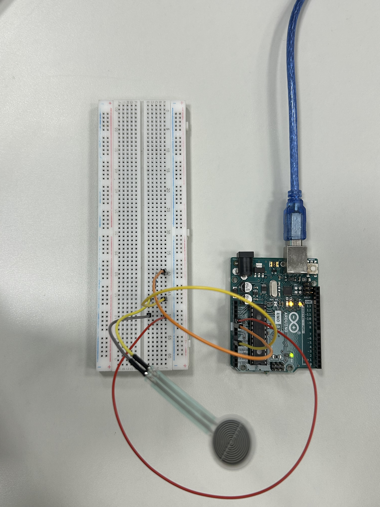
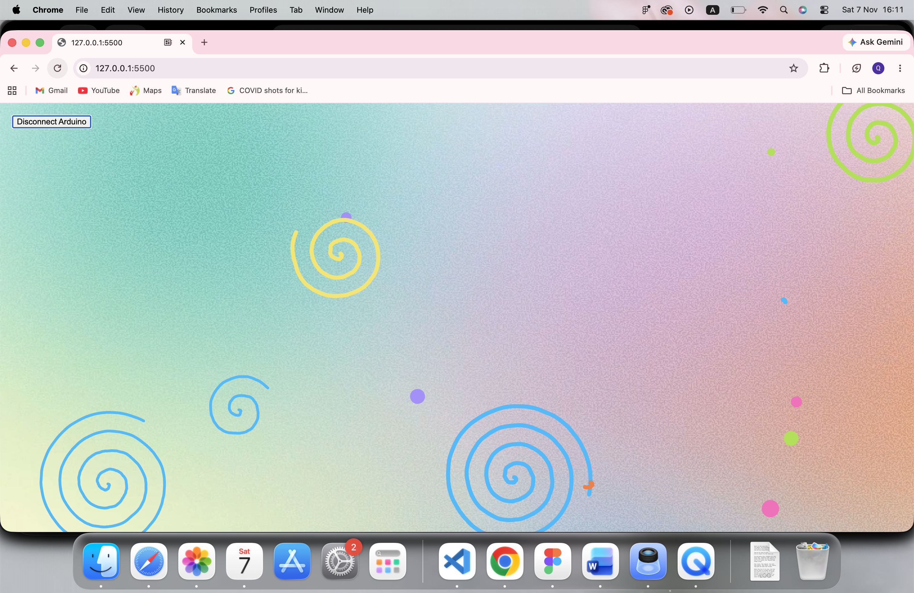
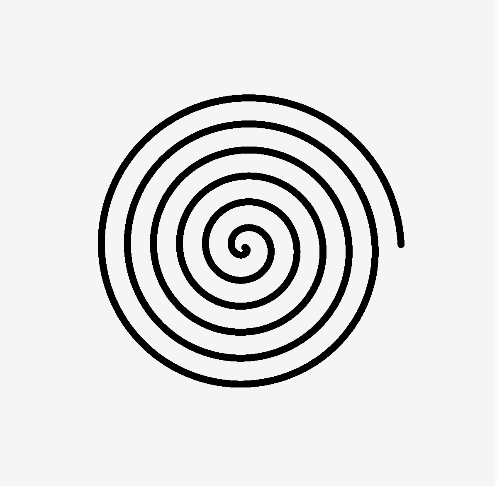
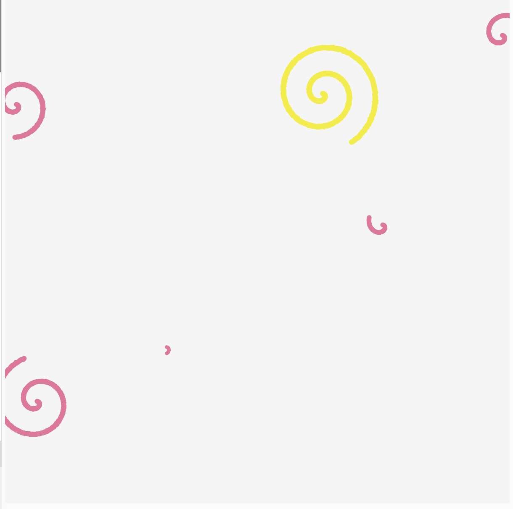

# Final Project — Swirly Swirls

I apologise for any loss of quality / short videos in the documention! I tried to make it as light as I could:)

I did (excluding the music, which is coded solely by Hao Tong): 
full credit: ball collision, background (creation and code), moodboard.
together with Hao Tong: ideation, spiral generating and collision (including hand-drawn effect)

---

### The Project

This p5.js sketch is an interactive audio-visual piece controlled by an Arduino sensor or the mouse. While the user presses (the sensor or the mouse), a hand-drawn-looking spiral grows on screen with a pencil-scratching sound. When the user lets go, the spiral is released and starts drifting around the canvas. Each time two spirals bump into each other, they bounce apart, change colour, and play a random musical note (Do, Re, Mi, Fa, So, La, Si). Small coloured balls float in the background over a looping video, adding movement and depth.

---

### Output

---

### ✍️ Reflection

My original idea is a spiral grows with a pencil-scratching sound while the user presses, then drifts freely and plays a note whenever it bumps into another spiral. The final result is really close to our idea I supposed!

The project responds to two inputs: once the force sensor value passes a threshold, the sketch treats it as a press. I structured the code around two classes: `Spiral`, the main drawn element that grows and then moves, and `Ball`, which adds ambient motion over a looping background video.

Visually, I wanted the spirals to feel hand-drawn rather than computer-perfect, so I added noise to the radius to make the line wobble slightly. I chose a bright, playful palette that stands out against the video. For the sound, I used the seven notes from Do to Si so that every collision produces something musical rather than random noise, and the pencil sound gives direct feedback while drawing.

My biggest challenge was collisions. At first, overlapping spirals triggered sounds every frame and got stuck bouncing back and forth. With help from AI, I added a table that remembers which pairs are already touching, so each hit plays only one note.

With more time, I would map the sensor's pressure to the spiral's thickness or growth speed, make notes depend on spiral size instead of being random, and fix the ball collisions to track each pair separately!

---

### Process

First, we learned to create a spiral using Polar Coordinates. We were able to create an interesting effect, similar to ink bleed, by randomizing the stroke weight:

Then, we added colours and make it floated onto the canvas. Basic collision was already applied here:

After that, we add the wombly effect using map(), noise() and floor():

Afterwards, I created background through Figma (to ensure the first and last frame are the same hehe) and looped it over the background. I also added balls / particles in just to have some for visual motion. Then we fixed the collions! (refer to outputs photos)

---

### ✨ Features
- Press the sensor (or mouse) to grow a hand-drawn spiral, with a looping pencil sound
- Release to let the spiral float and bounce around the screen
- Spirals that collide bounce apart, change colour, and play a note from Do to Si
- New spirals avoid spawning on top of existing ones
- Ambient floating balls over a looping background video

---

### 🔍 Code Structure
- `sketch.js` — setup, draw loop, serial input, collision logic, and the `Spiral` and `Ball` classes
- `index.html` — loads p5.js, p5.sound, and p5.webserial
- `background.mp4` — looping background video
- `DO.mp3` – `SI.mp3` — seven collision notes
- `Pencil.MP3` — drawing sound

---

### 🛠️ Hardware (if applicable)
- Arduino
- Force Sensor
- Resistor, wires, breadboard

---
### Something I Find Interesting

The spiral collisions were the hardest part to get right. At first, two overlapping spirals would trigger a note every single frame and get stuck bouncing back and forth inside each other. I worked through it by only checking spirals that have finished growing, and by keeping a `collisionPairs` table that remembers whether each pair is already touching. Now a collision only counts at the moment two spirals first meet, so each hit plays one clean note, swaps their colours, and sends them bouncing apart.

// Only check collision when both spirals are finished
if (!iIsNew && !jIsNew) {
  let d = dist(spiral[i].pos.x, spiral[i].pos.y,
               spiral[j].pos.x, spiral[j].pos.y);

  let r1 = 5 * spiral[i].angle;
  let r2 = 5 * spiral[j].angle;
  let colliding = d < (r1 + r2);

  // React only on the first frame of contact
  if (colliding && !collisionPairs[i][j]) {
    spiral[i].vel.mult(-1);
    spiral[j].vel.mult(-1);

    spiral[i].col = color(random(palette));
    spiral[j].col = color(random(palette));

    let note = floor(random(music.length));
    music[note].play();
  }

  collisionPairs[i][j] = colliding;
}